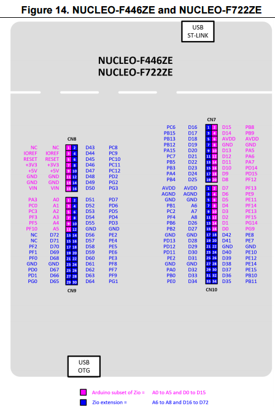
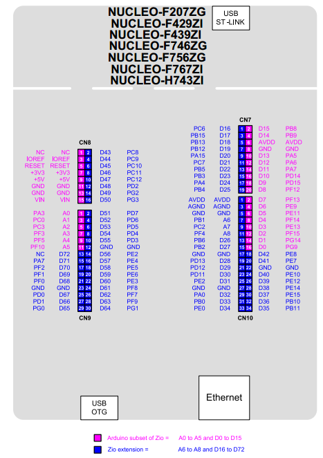

# LIG D&A 부트캠프 · Embedded Study

LIG D&A 부트캠프 임베디드 스터디에서 진행한 STM32 실습 모음입니다.

## 참고 문서

| 찾는 정보 | 기준 문서 |
|---|---|
| 핀 배치, 핀별 AF 번호, 전기적 특성(전압, 최대 클럭) | 데이터시트 (DS10693) |
| 레지스터 주소, 비트, 장치 동작 방식 | Reference Manual (RM0390) |
| Cortex-M4 코어 (NVIC, SysTick) | Programming Manual (PM0214) |
| 칩 자체의 알려진 버그 | Errata sheet (ES0298) |
| 보드 회로 (어느 핀이 어디에 연결됐나), 보드 핀맵, 커넥터(CN7–CN12), 점퍼 설정 | 보드 User Manual (UM1974) |

### 핀맵 (UM1974 발췌)

| NUCLEO-F446ZE / F722ZE (실습 보드) | NUCLEO-F207ZG / F429ZI / F746ZG 등 |
|:---:|:---:|
|  |  |

## 프로젝트

| 폴더 | 내용 | 핵심 |
|---|---|---|
| [pull-up-pull-down](pull-up-pull-down/) | 버튼 입력(PF13)을 읽어 LED(PF12) 제어, 입력값을 시리얼로 출력 | GPIO 입력 / 풀업·풀다운 저항, `printf` → USART3 |
| [UART](UART/) | USART6(PG14, 9600bps)으로 `'A'` 송신. HAL 코드를 레지스터까지 따라가 RM0390 기준으로 정리하고, HAL 없이 레지스터 주소에 직접 써서 동작하도록 옮김 | RCC / GPIO AF / USART BRR·CR1·SR 레지스터 |
