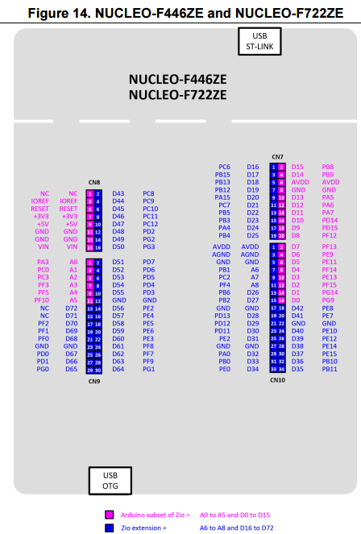
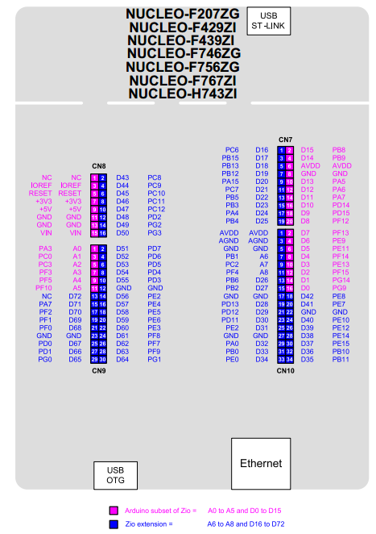

# LIG D&A 부트캠프 · Embedded Study

LIG D&A 부트캠프 임베디드 스터디에서 진행한 STM32 실습 모음입니다.

## 참고 문서

**DB3171 (Data Brief)**: NUCLEO-144 보드의 특징과 사양을 한눈에 보는 요약본

**UM1974 (User Manual)**: 보드 핀맵, 커넥터(CN7–CN12), 점퍼 설정 등 하드웨어 사용법

**RM0390 (Reference Manual)**: STM32F446 칩 내부 주변장치(RCC, GPIO, USART 등)의 레지스터 설명

### 핀맵 (UM1974 발췌)

| NUCLEO-F446ZE / F722ZE (실습 보드) | NUCLEO-F207ZG / F429ZI / F746ZG 등 |
|:---:|:---:|
|  |  |

## 프로젝트

| 폴더 | 내용 | 핵심 |
|---|---|---|
| [pull-up-pull-down](pull-up-pull-down/) | 버튼 입력(PF13)을 읽어 LED(PF12) 제어, 입력값을 시리얼로 출력 | GPIO 입력 / 풀업·풀다운 저항, `printf` → USART3 |
| [UART](UART/) | USART6(PG14, 9600bps)으로 `'A'` 송신. HAL 코드를 레지스터까지 따라가 RM0390 기준으로 정리하고, 레지스터 직접 제어 코드로 옮기기 | RCC / GPIO AF / USART BRR·CR1·SR 레지스터 |
