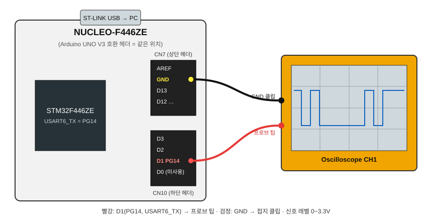
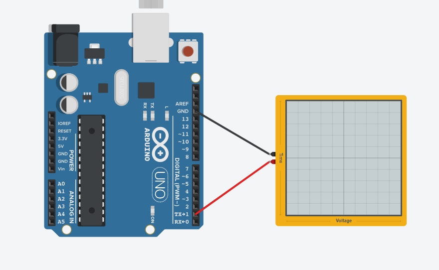

# UART · PG14로 'A' 송신 (HAL → 레지스터 직접 제어)

USART6으로 `'A'`(0x41)를 1초마다 보냅니다. 먼저 HAL로 동작을 확인하고, **HAL이 실제로 어떤 레지스터를 쓰는지** 따라간 다음, 최종적으로 **HAL 없이 레지스터 주소에 직접 값을 써서** 같은 동작을 만들었습니다.

- 보드: NUCLEO-F446ZE (STM32F446ZETx)
- USART6: **TX = PG14** (Arduino 헤더 D1). 송신만 하므로 RX는 사용하지 않음
- 설정: **9600bps, 8N1**
- 클럭: HSE 8MHz → PLL → SYSCLK 168MHz, APB2 = /2 → **PCLK2 84MHz** (USART6는 APB2 버스)
- 참고 문서: RM0390 (Reference Manual), DS10693 (Datasheet), UM1974 (NUCLEO-144)

> **현재 코드 상태**: CubeMX에서 USART6를 **Disable**했고, USART6 초기화와 송신은 [main.c](Core/Src/main.c)에서 레지스터로 직접 합니다. HAL은 `HAL_Init()`, 클럭 설정(`SystemClock_Config()`), `HAL_Delay()`에만 씁니다.
>
> `main.c`에 남아 있는 `huart3`(115200)는 ST-LINK 가상 COM 포트용 **USART3**(PD8/PD9)이고, 이 실습과는 관계없습니다.

## 진행 순서

1. **HAL 버전**: CubeMX로 USART6를 설정하고 `HAL_UART_Transmit()`로 송신해서 파형을 확인합니다. → [1장](#1-출발점-hal-버전)
2. **추적**: HAL 함수를 F12로 따라가서 실제로 쓰는 레지스터를 찾습니다. → [2장](#2-hal--레지스터-따라가기)
3. **정리**: RM0390을 보고 주소, 비트, 값을 정리합니다. → [3장](#3-레지스터-정리)
4. **교체**: CubeMX에서 USART6를 끄고 레지스터 코드로 바꿉니다. → [4장](#4-레지스터-직접-제어-코드)

> 4단계에서 CubeMX의 USART6를 꼭 Disable해야 합니다. `MX_USART6_UART_Init()`이 남아 있으면 HAL이 먼저 다 설정해 버려서, 내 레지스터 코드가 틀려도 동작하는 것처럼 보입니다. `main.c`에서 손으로 지우면 CubeMX로 다시 생성할 때 되살아납니다.

## 1. 출발점: HAL 버전


| 항목 | 값 |
|---|---|
| Mode / Flow Control | Asynchronous / Disable |
| Baud Rate | 9600 Bits/s |
| Word Length / Parity / Stop | 8 Bits / None / 1 |
| USART6_TX 핀 | **PG14** (기본값 PC6에서 변경) |

```c
/* main.c, while(1) 안 */
uint8_t ch = 'A';
HAL_UART_Transmit(&huart6, &ch, 1, HAL_MAX_DELAY);
HAL_Delay(1000);
```

## 2. HAL → 레지스터 따라가기

VSCode에서 함수/매크로 위에 커서를 두고 **F12**(또는 Ctrl+클릭)를 누르면 정의로 이동합니다. 돌아올 때는 **Alt+←**를 누릅니다.

| 단계 | HAL 코드 | 정의 위치 | 실제로 쓰는 레지스터 |
|---|---|---|---|
| ① 클럭 | `__HAL_RCC_GPIOG_CLK_ENABLE()`<br>`__HAL_RCC_USART6_CLK_ENABLE()` | `stm32f4xx_hal_rcc_ex.h` / `stm32f4xx_hal_rcc.h` | `RCC->AHB1ENR`, `RCC->APB2ENR` |
| ② 핀 | `HAL_GPIO_Init(GPIOG, ...)` | [stm32f4xx_hal_gpio.c:164](Drivers/STM32F4xx_HAL_Driver/Src/stm32f4xx_hal_gpio.c#L164) | `OSPEEDR`, `OTYPER`, `PUPDR`, `AFR[1]`, `MODER` |
| ③ USART 설정 | `HAL_UART_Init()` → `UART_SetConfig()` | [stm32f4xx_hal_uart.c](Drivers/STM32F4xx_HAL_Driver/Src/stm32f4xx_hal_uart.c) | `CR1`, `CR2`, `CR3`, `BRR` |
| ④ 송신 | `HAL_UART_Transmit()` | [stm32f4xx_hal_uart.c:1135](Drivers/STM32F4xx_HAL_Driver/Src/stm32f4xx_hal_uart.c#L1135) | `SR`(TXE 대기) → `DR`(쓰기) |

`GPIOG`, `USART6`이 무엇인지도 따라가 보면 결국 **주소에 구조체를 씌운 포인터**라는 걸 알 수 있습니다.

```c
// stm32f446xx.h
#define GPIOG_BASE   (AHB1PERIPH_BASE + 0x1800UL)    // 0x4002 1800
#define USART6_BASE  (APB2PERIPH_BASE + 0x1400UL)    // 0x4001 1400
#define GPIOG        ((GPIO_TypeDef *)  GPIOG_BASE)
#define USART6       ((USART_TypeDef *) USART6_BASE)
```

`GPIO_TypeDef`, `USART_TypeDef`의 멤버 순서는 RM0390 레지스터 맵의 오프셋 순서와 같습니다.

## 3. 레지스터 정리

### 3-1. 주소

| 주변장치 | 버스 | 버스 Base | Base |
|---|---|---|---|
| RCC | AHB1 | `0x4002 0000` | `0x4002 3800` |
| GPIOG | AHB1 | `0x4002 0000` | `0x4002 1800` |
| USART6 | APB2 | `0x4001 0000` | `0x4001 1400` |

### 3-2. RCC: 클럭 켜기

| 레지스터 | 주소 | 비트 | 값 |
|---|---|---|---|
| RCC_AHB1ENR | `0x4002 3830` | bit 6 `GPIOGEN` | 1 |
| RCC_APB2ENR | `0x4002 3844` | bit 5 `USART6EN` | 1 |

클럭이 꺼져 있으면 그 주변장치 레지스터에 써도 반영되지 않습니다(읽으면 0).

### 3-3. GPIOG: PG14 = AF8 (USART6_TX)

핀 n은 2비트 필드에서 `[2n+1:2n]` 위치를 씁니다. PG14는 **[29:28]**입니다. AF 번호는 4비트 필드이고, 핀 8~15는 `AFR[1]`(AFRH)에 들어갑니다. PG14는 AFRH의 **[27:24]**입니다 (`(14 - 8) × 4 = 24`).

| 레지스터 | 오프셋 | PG14 비트 | 값 | 의미 |
|---|---|---|---|---|
| MODER | `0x00` | [29:28] | `10` | Alternate function |
| OTYPER | `0x04` | 14 | `0` | Push-pull (리셋값) |
| OSPEEDR | `0x08` | [29:28] | `00` / `11` | 레지스터 코드: Low (리셋값) / HAL: Very high |
| PUPDR | `0x0C` | [29:28] | `00` | No pull (리셋값) |
| AFRH | `0x24` | [27:24] | `1000` | **AF8 = USART6** |

레지스터 코드에서는 **MODER와 AFRH만** 씁니다. 나머지는 리셋값이 이미 원하는 값입니다. OSPEEDR는 리셋값이 Low speed인데, 9600bps(1비트 ≈ 104µs)에는 충분합니다.

AF8 = USART6_TX라는 정보는 데이터시트(DS10693)의 Alternate function 표에 있습니다.

### 3-4. USART6

| 레지스터 | 오프셋 | 역할 |
|---|---|---|
| SR | `0x00` | 상태 (TXE, TC, RXNE …) |
| DR | `0x04` | 송수신 데이터 |
| BRR | `0x08` | 보드레이트 |
| CR1 | `0x0C` | enable, 데이터 길이, 패리티, TX/RX |
| CR2 | `0x10` | Stop 비트 |
| CR3 | `0x14` | 흐름제어, DMA |

**BRR 계산** (OVER8 = 0, 16배 오버샘플링)
```
USARTDIV = f_PCLK2 / (16 × Baud) = 84,000,000 / (16 × 9600) = 546.875
Mantissa = 546           = 0x222
Fraction = 0.875 × 16    = 14 = 0xE
BRR      = (0x222 << 4) | 0xE = 0x222E
```

`(Mantissa << 4) | Fraction`은 `USARTDIV × 16`과 같고, 이 값은 `f_PCLK2 / Baud`입니다. 그래서 OVER8 = 0일 때는 **정수 나눗셈 한 번**으로 BRR을 구할 수 있습니다.
```
BRR = f_PCLK2 / Baud = 84,000,000 / 9600 = 8750 = 0x222E
```

**CR1**

| 비트 | 이름 | 값 | 의미 |
|---|---|---|---|
| 13 | UE | 1 | USART enable |
| 12 | M | 0 | 8비트 데이터 |
| 10 | PCE | 0 | 패리티 없음 |
| 3 | TE | 1 | 송신 enable |
| 2 | RE | 0 | 수신 안 함 (HAL 버전은 1) |

→ CR1 = `0x2008` (HAL 버전은 TX/RX 모두 켜서 `0x200C`). CR2, CR3는 리셋값 `0`(Stop 1비트, 흐름제어 없음)을 그대로 씁니다.

**SR**

| 비트 | 이름 | 의미 |
|---|---|---|
| 7 | TXE | DR이 비었음 → 다음 바이트를 써도 됨 |
| 6 | TC | 마지막 비트까지 송신 완료 |
| 5 | RXNE | 수신 데이터 있음 |

## 4. 레지스터 직접 제어 코드

전체 코드는 [main.c](Core/Src/main.c)에 있습니다. CMSIS 구조체(`USART6->BRR`)도 쓰지 않고, **RM0390의 주소를 직접 매크로로 만들어** 씁니다.

### 4-1. 주소 매크로 ([main.c:38](Core/Src/main.c#L38), `USER CODE BEGIN PM`)

```c
#define PCLK2_HZ   84000000UL
#define BAUDRATE   9600UL

#define MY_AHB1_BASE 0x40020000UL

#define MY_RCC_BASE    (MY_AHB1_BASE + 0x3800UL)
#define MY_RCC_AHB1ENR (*(volatile uint32_t *) (MY_RCC_BASE + 0x30UL))
#define MY_RCC_APB2ENR (*(volatile uint32_t *) (MY_RCC_BASE + 0x44UL))

#define MY_GPIOG_BASE  (MY_AHB1_BASE + 0x1800UL)
#define MY_GPIOG_MODER (*(volatile uint32_t *) (MY_GPIOG_BASE + 0x00UL))
#define MY_GPIOG_AFRH  (*(volatile uint32_t *) (MY_GPIOG_BASE + 0x24UL))

#define MY_APB2_BASE 0x40010000UL

#define MY_USART6_BASE (MY_APB2_BASE + 0x1400UL)
#define MY_USART6_SR   (*(volatile uint32_t *) (MY_USART6_BASE + 0x00UL))
#define MY_USART6_DR   (*(volatile uint32_t *) (MY_USART6_BASE + 0x04UL))
#define MY_USART6_BRR  (*(volatile uint32_t *) (MY_USART6_BASE + 0x08UL))
#define MY_USART6_CR1  (*(volatile uint32_t *) (MY_USART6_BASE + 0x0CUL))

#define MY_RCC_AHB1ENR_GPIOGEN  (1U << 6)
#define MY_RCC_APB2ENR_USART6EN (1U << 5)
#define MY_USART6_SR_TXE        (1U << 7)
#define MY_USART6_SR_TC         (1U << 6)
#define MY_USART6_CR1_UE        (1U << 13)
#define MY_USART6_CR1_TE        (1U << 3)
```

- `*(volatile uint32_t *) 주소`: 주소를 32비트 포인터로 바꾸고 바로 역참조합니다. 그래서 `MY_USART6_DR = ch;`처럼 변수처럼 읽고 쓸 수 있습니다.
- `volatile`: 하드웨어가 값을 바꾸는 레지스터이니 컴파일러가 읽기/쓰기를 생략하거나 캐시하지 못하게 합니다. 이게 없으면 `while (!(SR & TXE));`가 무한 루프가 될 수 있습니다.
- **`MY_` 접두사**: `main.h`가 포함하는 CMSIS 헤더(`stm32f446xx.h`)에 이미 `USART6_BASE`, `GPIOG_BASE` 같은 이름이 있습니다. 같은 이름을 다시 `#define`하면 redefinition 경고가 나서 이름을 구분했습니다.

### 4-2. 초기화 ([main.c:122](Core/Src/main.c#L122), `USER CODE BEGIN 2`)

```c
// ① 클럭
MY_RCC_AHB1ENR |= MY_RCC_AHB1ENR_GPIOGEN;
MY_RCC_APB2ENR |= MY_RCC_APB2ENR_USART6EN;

// ② PG14 = AF8
MY_GPIOG_MODER &= ~(0b11U << 28);      // [29:28] 지우고
MY_GPIOG_MODER |=  (0b10U << 28);      // 10 = AF
MY_GPIOG_AFRH  &= ~(0b1111U << 24);    // [27:24] 지우고
MY_GPIOG_AFRH  |=  (0b1000U << 24);    // AF8

// ③ 보레이트 → enable
MY_USART6_BRR = (PCLK2_HZ + BAUDRATE / 2) / BAUDRATE;   // = 8750 = 0x222E
MY_USART6_CR1 |= MY_USART6_CR1_UE;
MY_USART6_CR1 |= MY_USART6_CR1_TE;
```

- 비트 필드는 **먼저 지우고(`&= ~mask`) 그다음 쓰는(`|=`)** 순서로 바꿉니다. 그래야 같은 레지스터의 다른 핀 설정(예: PG6 Output)이 유지됩니다.
- BRR은 3-4의 정수 공식에 반올림(`+ BAUDRATE / 2`)을 더한 것입니다. `main.c`에는 비교용으로 다른 두 가지 방법도 주석으로 남겨 두었습니다.

  | 방법 | 코드 | 특징 |
  |---|---|---|
  | 전부 계산 | `float USARTDIV` → Mantissa / Fraction 분리 → 합치기 | RM0390 공식 그대로. float 연산 필요 |
  | **정수 계산 (사용 중)** | `(PCLK2_HZ + BAUDRATE / 2) / BAUDRATE` | 한 줄. OVER8 = 0일 때만 성립 |
  | 하드코딩 | `0x222E` | 클럭이나 보레이트를 바꾸면 직접 다시 계산해야 함 |

- `PCLK2_HZ`는 `SystemClock_Config()`의 결과(84MHz)를 전제로 한 값입니다. CubeMX에서 클럭을 바꾸면 이 값도 같이 바꿔야 합니다.

### 4-3. 송신 ([main.c:163](Core/Src/main.c#L163), `USER CODE BEGIN 3`)

```c
uint8_t ch = 'A';
while (!(MY_USART6_SR & MY_USART6_SR_TXE));   // DR이 빌 때까지 대기
MY_USART6_DR = ch;                            // 쓰는 순간 송신 시작
while (!(MY_USART6_SR & MY_USART6_SR_TC));    // 마지막 비트까지 나갈 때까지 대기
HAL_Delay(1000);
```

TC 대기는 없어도 동작합니다. 연속으로 보낼 때는 TXE만 기다리는 게 더 빠르고, TC는 전송이 완전히 끝났는지 확인해야 할 때(전원 차단, RS-485 방향 전환 등) 씁니다.

## 5. 레지스터 값 확인 (디버거)

`while (1)`에 브레이크포인트를 걸고 Debug Console에서 확인합니다.

```
x/4wx 0x40011400    # USART6: SR, DR, BRR, CR1
x/1wx 0x40021800    # GPIOG_MODER
x/1wx 0x40021824    # GPIOG_AFRH
```

| 레지스터 | 기대값 |
|---|---|
| USART6_BRR | `0x0000 222E` |
| USART6_CR1 | `0x0000 2008` (UE, TE) |
| USART6_SR (대기 중) | `0x0000 00C0` 근처 (TXE, TC = 1) |
| GPIOG_MODER | `0x2000 1000` (PG14 = AF, PG6 = Output) |
| GPIOG_AFRH | `0x0800 0000` |

PG6 Output은 `MX_GPIO_Init()`이 설정한 USB 전원 스위치 핀입니다. Watch 창에 `MY_USART6_BRR`처럼 매크로 이름을 넣으면 안 되고, `*(uint32_t *)0x40011408`처럼 주소로 입력해야 합니다. STM32Cube Registers 확장을 쓰면 비트 단위로 볼 수 있습니다.

## 6. 연결 / 확인

| NUCLEO 헤더 | STM32 핀 | 연결 |
|---|---|---|
| D1 (CN10) | **PG14** (USART6_TX) | 오실로스코프 프로브 / USB-TTL **RX** |
| GND (CN7) | GND | 접지 |





### 6-1. 시리얼 모니터

보드의 USB(ST-LINK) 가상 COM 포트는 **USART3**(PD8/PD9)에 연결되어 있습니다. USART6(PG14)은 USB로 나가지 않기 때문에, PC에서 보려면 **3.3V USB-TTL 변환기**(CP2102, CH340, FT232 등)가 필요합니다.

1. 변환기 RX → PG14 (D1), GND → GND
2. VSCode **Serial Monitor** 확장 → 변환기 COM 포트 선택
3. Baud rate **9600**으로 설정 (기본값 115200이면 글자가 깨짐)
4. Start Monitoring → 1초마다 `A`가 찍히면 성공

### 6-2. 오실로스코프

9600bps에서 1비트는 약 **104µs**입니다. `'A'` = `0x41` = `0100 0001`은 LSB부터 나갑니다.
```
Start  b0 b1 b2 b3 b4 b5 b6 b7  Stop
  0     1  0  0  0  0  0  1  0    1
```
오실로스코프 설정: DC, 1V/div, 100µs/div, Falling edge 트리거 ≈1.5V
