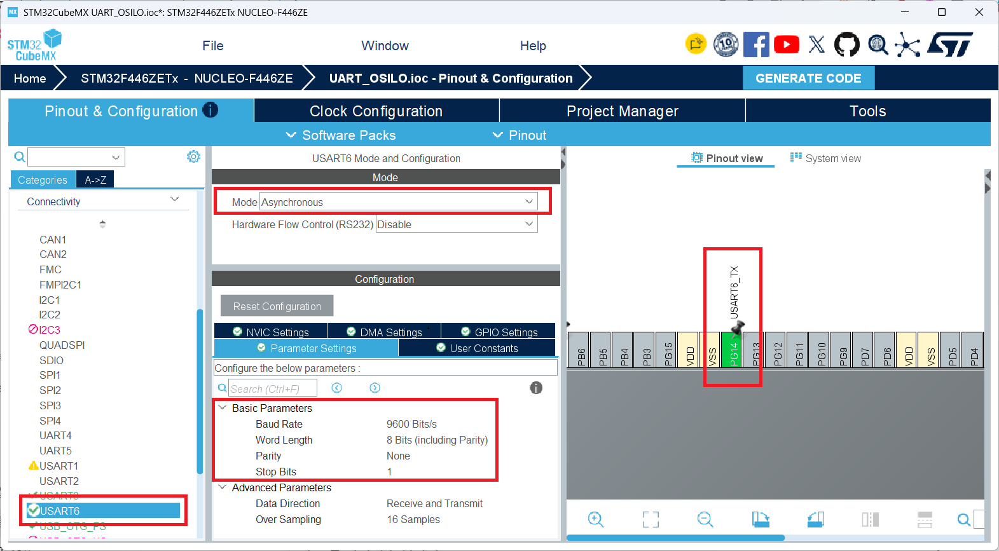

# UART · HAL 없이 레지스터만으로 'A' 송신

USART3로 `'A'`(0x41)를 약 1초마다 보내고, **VS Code 시리얼 모니터**에서 확인합니다. 처음에는 HAL로 동작을 확인했고, HAL이 어떤 레지스터를 쓰는지 따라간 다음, 최종적으로 **`HAL_Init()`, `SystemClock_Config()`까지 빼고 레지스터만으로** 동작하게 만들었습니다.

| 항목 | 현재 설정 |
|---|---|
| 보드 | NUCLEO-F446ZE (STM32F446ZETx) |
| UART | **USART3, TX = PD8** → 보드의 ST-LINK USB 가상 COM 포트로 연결됨 (선 연결 불필요) |
| 통신 설정 | **9600bps, 8N1** |
| 클럭 | 리셋 기본값 **HSI 16MHz**, APB1 /1 → **PCLK1 16MHz** (`SystemClock_Config()` 호출 안 함) |
| 지연 | `HAL_Delay()` 대신 **`for` 빈 반복문** (약 1초) |
| HAL | `HAL_Init()`, `SystemClock_Config()`, `MX_*_Init()` 모두 주석 처리 |

참고 문서: RM0390 (Reference Manual), DS10693 (Datasheet), UM1974 (NUCLEO-144), PM0214 (Cortex-M4 Programming Manual)

---

## 1. 빌드 · 굽기 · 시리얼 모니터로 확인하기

### 1-1. 준비물

| 준비물 | 설명 |
|---|---|
| USB 케이블 | 보드 위쪽 **CN1 (ST-LINK)** 포트에 연결. 충전 전용 케이블은 안 됨 |
| STM32 Build & Flash 확장 | 이 저장소의 [vscode-stm32-buttons](../vscode-stm32-buttons/) (직접 만든 VS Code 확장) |
| Serial Monitor 확장 | Microsoft의 `ms-vscode.vscode-serial-monitor` (VS Code 마켓플레이스) |
| STM32Cube for VS Code | CMake/Ninja 툴체인과 `STM32_Programmer_CLI`를 설치해 줌 |

> NUCLEO-F446ZE에는 USB 포트가 두 개 있습니다. **CN1(ST-LINK, 위쪽)**은 굽기·디버그·가상 COM 포트용이고, CN13(USB OTG, 아래쪽)은 STM32 자체 USB 기능용입니다. 이 실습은 **CN1 하나만** 씁니다.

### 1-2. STM32 Build & Flash 확장 (빌드 + 굽기 버튼)

STM32Cube 확장만으로는 빌드와 굽기 버튼이 따로 없어서, **상태바에 Build / Flash 버튼을 추가하는 확장**을 만들어 쓰고 있습니다. Node나 vsce 없이 PowerShell 스크립트로 바로 설치됩니다.

**설치**
```powershell
cd vscode-stm32-buttons
.\install.ps1
```
`.vsix`로 패키징한 다음 기본 프로필과 `STM32 Profile` 프로필 양쪽에 설치합니다. 설치 후 VS Code를 다시 로드하세요.

**사용**

VS Code에서 **`UART` 폴더를 워크스페이스로 엽니다.** 확장은 `CMakePresets.json`이 있는 폴더를 프로젝트로 찾습니다.

| 버튼 (상태바 왼쪽) | 단축키 | 하는 일 |
|---|---|---|
| 🔧 **STM32 Build** | `Ctrl+Alt+B` | `cmake --preset Debug`(처음 한 번) → `cmake --build --preset Debug` |
| ⚡ **STM32 Flash** | `Ctrl+Alt+F` | 빌드 → `STM32_Programmer_CLI -c port=SWD -w UART.elf -v -rst` |
| ⚙ **Debug** | – | 빌드 preset 변경 (Debug / Release) |

- **Flash = 빌드 + 굽기 + 검증 + 리셋**입니다. `-rst`로 리셋까지 하기 때문에, 굽기가 끝나면 Run을 따로 누르지 않아도 바로 실행됩니다.
- 빌드 에러는 Problems 탭에 표시됩니다.
- 깨끗하게 다시 빌드하려면 `Ctrl+Shift+P` → **STM32: Clean Rebuild**를 실행합니다.
- `STM32_Programmer_CLI`는 PATH → `%LOCALAPPDATA%\stm32cube\bundles\programmer` → `C:\Program Files\STMicroelectronics\...` 순서로 자동으로 찾습니다. 못 찾으면 설정 `stm32bf.programmerPath`에 경로를 직접 넣으세요.

### 1-3. VS Code 시리얼 모니터로 보기

1. CN1에 USB를 연결하고 **⚡ STM32 Flash**로 굽습니다.
2. `Ctrl+Shift+P` → **Serial Monitor: Focus** (또는 하단 패널의 **SERIAL MONITOR** 탭)
3. 아래처럼 설정합니다.

   | 항목 | 값 |
   |---|---|
   | Monitor Mode | Serial |
   | Port | **STMicroelectronics STLink Virtual COM Port (COMx)** |
   | Baud rate | **9600** (기본값 115200이면 글자가 깨짐) |
   | Line ending | None |

4. **Start Monitoring**을 누르면 `AAAA…`가 약 1초에 하나씩 찍힙니다. 줄바꿈을 보내지 않아서 한 줄로 이어집니다.

**포트가 헷갈릴 때**
- `표준 Bluetooth에서 직렬 링크(COM4)` 같은 포트는 **블루투스 가상 포트**이니 고르면 안 됩니다.
- 보드를 꽂았다 뺐다 하면서 **새로 생기는 포트**가 ST-LINK입니다. 장치 관리자 → 포트(COM & LPT)에서 확인할 수 있습니다.
- ST-LINK 포트가 아예 안 보이면 다음을 확인하세요.
  - CN1에 꽂았는지
  - LD1(COM)·LD3(PWR) LED가 켜지는지
  - 데이터 전송이 되는 케이블인지
  - ST-LINK 드라이버(STSW-LINK009)가 설치되어 있는지

**`Closed serial port … due to disconnection` 메시지**
굽는 동안 ST-LINK가 리셋되면서 COM 포트가 잠깐 끊긴 것입니다. 굽기가 끝나면 **Start Monitoring**을 다시 누르면 됩니다.

---

## 2. 진행 과정

| 단계 | UART / 핀 | 초기화 | 확인 방법 |
|---|---|---|---|
| ① HAL 버전 | USART6 / PG14 | CubeMX + `HAL_UART_Transmit()` | 오실로스코프 |
| ② HAL → 레지스터 추적 | – | F12로 HAL 내부 따라가기 | – |
| ③ 레지스터 직접 제어 | USART6 / PG14 | CubeMX에서 USART6 Disable, 주소 매크로로 직접 설정 | 오실로스코프 |
| ④ ST-LINK COM 포트로 변경 | **USART3 / PD8** | 레지스터 (PCLK1 42MHz 기준) | **시리얼 모니터** |
| ⑤ HAL 완전히 제거 | USART3 / PD8 | `HAL_Init()`, `SystemClock_Config()`까지 주석 처리 → HSI 16MHz, `for` 지연 | 시리얼 모니터 |

④에서 USART3로 바꾼 이유는 USART6(PG14)이 USB로 나가지 않기 때문입니다. PC에서 보려면 USB-TTL 변환기가 따로 필요합니다. 반면 USART3(PD8)는 보드 안에서 ST-LINK에 연결되어 있어서, USB 케이블 하나로 바로 볼 수 있습니다.

---

## 3. HAL → 레지스터 따라가기

VS Code에서 함수나 매크로 위에 커서를 두고 **F12**(또는 Ctrl+클릭)를 누르면 정의로 이동합니다. 돌아올 때는 **Alt+←**를 누릅니다.

| 단계 | HAL 코드 | 정의 위치 | 실제로 쓰는 레지스터 |
|---|---|---|---|
| ① 클럭 | `__HAL_RCC_GPIOx_CLK_ENABLE()`<br>`__HAL_RCC_USARTx_CLK_ENABLE()` | `stm32f4xx_hal_rcc_ex.h` / `stm32f4xx_hal_rcc.h` | `RCC->AHB1ENR`, `RCC->APB1ENR` / `APB2ENR` |
| ② 핀 | `HAL_GPIO_Init()` | [stm32f4xx_hal_gpio.c:164](Drivers/STM32F4xx_HAL_Driver/Src/stm32f4xx_hal_gpio.c#L164) | `OSPEEDR`, `OTYPER`, `PUPDR`, `AFR[1]`, `MODER` |
| ③ USART 설정 | `HAL_UART_Init()` → `UART_SetConfig()` | [stm32f4xx_hal_uart.c](Drivers/STM32F4xx_HAL_Driver/Src/stm32f4xx_hal_uart.c) | `CR1`, `CR2`, `CR3`, `BRR` |
| ④ 송신 | `HAL_UART_Transmit()` | [stm32f4xx_hal_uart.c:1135](Drivers/STM32F4xx_HAL_Driver/Src/stm32f4xx_hal_uart.c#L1135) | `SR`(TXE 대기) → `DR`(쓰기) |

`GPIOD`, `USART3` 같은 이름도 따라가 보면 결국 **주소에 구조체를 씌운 포인터**입니다.

```c
// stm32f446xx.h
#define GPIOD_BASE   (AHB1PERIPH_BASE + 0x0C00UL)    // 0x4002 0C00
#define USART3_BASE  (APB1PERIPH_BASE + 0x4800UL)    // 0x4000 4800
#define GPIOD        ((GPIO_TypeDef *)  GPIOD_BASE)
#define USART3       ((USART_TypeDef *) USART3_BASE)
```

---

## 4. 레지스터 정리 (USART3 / PD8)

### 4-1. 주소

| 주변장치 | 버스 | 버스 Base | Base |
|---|---|---|---|
| RCC | AHB1 | `0x4002 0000` | `0x4002 3800` |
| GPIOD | AHB1 | `0x4002 0000` | `0x4002 0C00` |
| USART3 | **APB1** | `0x4000 0000` | `0x4000 4800` |

### 4-2. RCC: 클럭 켜기

| 레지스터 | 주소 | 비트 | 값 |
|---|---|---|---|
| RCC_AHB1ENR | `0x4002 3830` | bit 3 `GPIODEN` | 1 |
| RCC_APB1ENR | `0x4002 3840` | bit 18 `USART3EN` | 1 |

클럭이 꺼져 있으면 그 주변장치 레지스터에 써도 반영되지 않습니다(읽으면 0).

### 4-3. GPIOD: PD8 = AF7 (USART3_TX)

핀 n은 2비트 필드에서 `[2n+1:2n]` 위치를 씁니다. PD8은 **[17:16]**입니다. 핀 8~15의 AF는 AFRH에 들어가고, PD8은 AFRH의 **[3:0]**입니다 (`(8 - 8) × 4 = 0`).

| 레지스터 | 오프셋 | PD8 비트 | 값 | 의미 |
|---|---|---|---|---|
| MODER | `0x00` | [17:16] | `10` | Alternate function |
| OTYPER | `0x04` | 8 | `0` | Push-pull (리셋값) |
| OSPEEDR | `0x08` | [17:16] | `00` | Low speed (리셋값, 9600bps엔 충분) |
| PUPDR | `0x0C` | [17:16] | `00` | No pull (리셋값) |
| AFRH | `0x24` | [3:0] | `0111` | **AF7 = USART3** |

코드에서는 **MODER와 AFRH만** 씁니다. AF7 = USART3_TX라는 정보는 데이터시트(DS10693)의 Alternate function 표에 있습니다.

### 4-4. USART3

| 레지스터 | 오프셋 | 역할 |
|---|---|---|
| SR | `0x00` | 상태 (TXE, TC, RXNE …) |
| DR | `0x04` | 송수신 데이터 |
| BRR | `0x08` | 보드레이트 |
| CR1 | `0x0C` | enable, 데이터 길이, 패리티, TX/RX |
| CR2 | `0x10` | Stop 비트 (리셋값 0 = 1비트) |
| CR3 | `0x14` | 흐름제어, DMA (리셋값 0 = 없음) |

**BRR 계산** (OVER8 = 0, 16배 오버샘플링, PCLK1 = 16MHz)
```
USARTDIV = f_PCLK1 / (16 × Baud) = 16,000,000 / (16 × 9600) = 104.1667
Mantissa = 104                 = 0x68
Fraction = 0.1667 × 16 ≈ 2.67 → 2 (버림) / 3 (반올림)
BRR      = (0x68 << 4) | 0x2  = 0x682
```
`(Mantissa << 4) | Fraction`은 `USARTDIV × 16 = f_PCLK1 / Baud`와 같습니다. 그래서 코드에서는 정수 나눗셈 한 번으로 구합니다.
```
BRR = 16,000,000 / 9600 = 1666 (버림) = 0x682  → 실제 9603.8bps, 오차 0.04%
```

**CR1**

| 비트 | 이름 | 값 | 의미 |
|---|---|---|---|
| 13 | UE | 1 | USART enable |
| 12 | M | 0 | 8비트 데이터 |
| 10 | PCE | 0 | 패리티 없음 |
| 3 | TE | 1 | 송신 enable |
| 2 | RE | 0 | 수신 안 함 |

→ CR1 = `0x2008`

**SR**

| 비트 | 이름 | 의미 |
|---|---|---|
| 7 | TXE | DR이 비었음 → 다음 바이트를 써도 됨 |
| 6 | TC | 마지막 비트까지 송신 완료 |
| 5 | RXNE | 수신 데이터 있음 |

---

## 5. HAL을 완전히 빼면 무슨 일이 생기나

`HAL_Init()`과 `SystemClock_Config()`를 주석 처리하면 처음에는 **A가 하나도 안 나옵니다.** 원인은 두 가지가 겹쳐서입니다.

### 5-1. `HAL_Delay()`에서 영원히 멈춤 (`HAL_Init()`을 뺀 영향)

`HAL_Init()`은 내부에서 `HAL_InitTick()`을 호출합니다. 이 함수가 **SysTick 타이머가 1ms마다 인터럽트를 내도록** 설정하고, 그 인터럽트가 올 때마다 `uwTick`이 1씩 늘어납니다.

```
HAL_Delay(1000)
 └ uwTick이 1000 늘어날 때까지 대기
    └ SysTick이 꺼져 있음 → uwTick = 0 그대로 → 영원히 대기
```
`HAL_Delay()` 함수는 코드에 들어 있어서 정상적으로 호출됩니다. 하지만 시간을 세 주는 SysTick이 꺼져 있어서, 루프가 한 번만 돌고 멈춥니다.

### 5-2. 첫 글자도 깨짐 (`SystemClock_Config()`를 뺀 영향)

| | SystemClock_Config 있음 | 없음 (리셋 기본값) |
|---|---|---|
| SYSCLK | HSE 8MHz → PLL → **168MHz** | **HSI 16MHz** |
| APB1 (PCLK1) | /4 → **42MHz** | /1 → **16MHz** |
| BRR (9600) | `0x1117` | `0x682` |

BRR을 42MHz 기준(`0x1117`)으로 둔 채 실제 클럭이 16MHz면 `16,000,000 / 4375 ≈ 3657bps`로 나갑니다. 시리얼 모니터는 9600으로 받으니 글자가 깨집니다.

### 5-3. 해결

| 문제 | 해결 |
|---|---|
| 클럭이 16MHz로 바뀜 | `PCLK1_HZ`를 `16000000UL`로 변경 → BRR이 자동으로 `0x682` |
| `HAL_Delay()`가 멈춤 | `for (volatile uint32_t i = 0; i < 1600000; i++);` 빈 반복문으로 대체 |

빈 반복문은 CPU가 명령을 실행하는 것만으로 시간이 흐르기 때문에, 타이머나 인터럽트 설정이 필요 없습니다.
- **`volatile`이 꼭 필요합니다.** 없으면 컴파일러가 "아무 일도 안 하는 반복문"이라고 판단해서 통째로 지울 수 있습니다.
- 정확한 시간은 아닙니다. Debug(-O0) 빌드 기준으로 대략 1초이고, 최적화 수준이 바뀌면 달라집니다.

---

## 6. 코드 ([main.c](Core/Src/main.c))

CMSIS 구조체(`USART3->BRR`)도 쓰지 않고, **RM0390의 주소를 직접 매크로로 만들어** 씁니다.

### 6-1. 주소 매크로 (`USER CODE BEGIN PM`)

```c
#define PCLK1_HZ   16000000UL   // HSI 16MHz, APB1 /1 (SystemClock_Config 안 씀)
#define BAUDRATE   9600UL

#define MY_AHB1_BASE 0x40020000UL

#define MY_RCC_BASE    (MY_AHB1_BASE + 0x3800UL)
#define MY_RCC_AHB1ENR (*(volatile uint32_t *) (MY_RCC_BASE + 0x30UL)) // GPIODEN : bit 3
#define MY_RCC_APB1ENR (*(volatile uint32_t *) (MY_RCC_BASE + 0x40UL)) // USART3EN : bit 18

#define MY_GPIOD_BASE  (MY_AHB1_BASE + 0x0C00UL)
#define MY_GPIOD_MODER (*(volatile uint32_t *) (MY_GPIOD_BASE + 0x00UL)) // PD8: [17:16] = 10 (AF)
#define MY_GPIOD_AFRH  (*(volatile uint32_t *) (MY_GPIOD_BASE + 0x24UL)) // PD8: [3:0] = 0111 (AF7)

#define MY_APB1_BASE 0x40000000UL

#define MY_USART3_BASE (MY_APB1_BASE + 0x4800UL)
#define MY_USART3_SR   (*(volatile uint32_t *) (MY_USART3_BASE + 0x00UL)) // TXE: 7, TC: 6, RXNE: 5
#define MY_USART3_DR   (*(volatile uint32_t *) (MY_USART3_BASE + 0x04UL)) // DR[8:0]
#define MY_USART3_BRR  (*(volatile uint32_t *) (MY_USART3_BASE + 0x08UL)) // Mantissa[15:4], Fraction[3:0]
#define MY_USART3_CR1  (*(volatile uint32_t *) (MY_USART3_BASE + 0x0CUL)) // UE: 13, TE: 3, RE: 2

#define MY_RCC_AHB1ENR_GPIODEN  (1U << 3)
#define MY_RCC_APB1ENR_USART3EN (1U << 18)
#define MY_USART3_SR_TXE        (1U << 7)
#define MY_USART3_SR_TC         (1U << 6)
#define MY_USART3_CR1_UE        (1U << 13)
#define MY_USART3_CR1_TE        (1U << 3)
```

- `*(volatile uint32_t *) 주소`: 주소를 32비트 포인터로 바꾸고 바로 역참조합니다. 그래서 `MY_USART3_DR = ch;`처럼 변수처럼 읽고 쓸 수 있습니다.
- `volatile`: 하드웨어가 값을 바꾸는 레지스터이니 컴파일러가 읽기/쓰기를 생략하지 못하게 합니다. 없으면 `while (!(SR & TXE));`가 무한 루프가 될 수 있습니다.
- **`MY_` 접두사**: `main.h`가 포함하는 CMSIS 헤더(`stm32f446xx.h`)에 이미 `USART3_BASE`, `GPIOD_BASE` 같은 이름이 있습니다. 같은 이름을 다시 `#define`하면 redefinition 경고가 나서 이름을 구분했습니다.

### 6-2. `main()`

```c
// HAL_Init();               ← SysTick, Flash 설정 (안 씀)
// SystemClock_Config();     ← PLL 168MHz (안 씀 → HSI 16MHz)
// MX_GPIO_Init(); MX_USART3_UART_Init(); MX_USB_OTG_FS_PCD_Init();

// ① 클럭
MY_RCC_AHB1ENR |= MY_RCC_AHB1ENR_GPIODEN;
MY_RCC_APB1ENR |= MY_RCC_APB1ENR_USART3EN;

// ② PD8 = AF7 (먼저 지우고 → 쓰기)
MY_GPIOD_MODER &= ~(0b11U << 16);
MY_GPIOD_MODER |=  (0b10U << 16);
MY_GPIOD_AFRH  &= ~(0b1111U << 0);
MY_GPIOD_AFRH  |=  (0b0111U << 0);

// ③ USART3: 9600 8N1, 송신만
MY_USART3_CR1 = 0;
MY_USART3_BRR = PCLK1_HZ / BAUDRATE;   // 1666 = 0x682
MY_USART3_CR1 |= MY_USART3_CR1_UE;
MY_USART3_CR1 |= MY_USART3_CR1_TE;

while (1)
{
    // ④ 송신
    uint8_t ch = 'A';
    while (!(MY_USART3_SR & MY_USART3_SR_TXE));   // DR이 빌 때까지 대기
    MY_USART3_DR = ch;                            // 쓰는 순간 송신 시작
    while (!(MY_USART3_SR & MY_USART3_SR_TC));    // 마지막 비트까지 나갈 때까지 대기

    // ⑤ 약 1초 대기
    for (volatile uint32_t i = 0; i < 1600000; i++);
}
```

- 비트 필드는 **먼저 지우고(`&= ~mask`) 그다음 쓰는(`|=`)** 순서로 바꿉니다. 그래야 같은 레지스터의 다른 핀 설정이 유지됩니다.
- BRR은 비교용으로 다른 두 가지 방법도 `main.c`에 주석으로 남겨 두었습니다.

  | 방법 | 코드 | 특징 |
  |---|---|---|
  | 전부 계산 | `float USARTDIV` → Mantissa / Fraction 분리 → 합치기 | RM0390 공식 그대로. float 연산 필요 |
  | **정수 계산 (사용 중)** | `PCLK1_HZ / BAUDRATE` | 한 줄. OVER8 = 0일 때만 성립 |
  | 하드코딩 | `0x682` | 클럭이나 보레이트를 바꾸면 직접 다시 계산해야 함 |

---

## 7. 레지스터 값 확인 (디버거)

`while (1)`에 브레이크포인트를 걸고 Debug Console에서 확인합니다.

```
x/4wx 0x40004800    # USART3: SR, DR, BRR, CR1
x/1wx 0x40020C00    # GPIOD_MODER
x/1wx 0x40020C24    # GPIOD_AFRH
```

| 레지스터 | 기대값 |
|---|---|
| USART3_BRR | `0x0000 0682` |
| USART3_CR1 | `0x0000 2008` (UE, TE) |
| USART3_SR (대기 중) | `0x0000 00C0` 근처 (TXE, TC = 1) |
| GPIOD_MODER | `0x0002 0000` (PD8만 AF. `MX_GPIO_Init()`을 안 불러 나머지는 리셋값) |
| GPIOD_AFRH | `0x0000 0007` |

브레이크포인트에서 멈춰 있는 동안에는 송신도 멈춥니다. Continue(F5)를 누르면 시리얼 모니터에 다시 찍힙니다.

---

## 8. 다음 단계: SysTick으로 정확한 지연 만들기

빈 반복문 대신 Cortex-M4 코어 타이머인 **SysTick**을 레지스터로 직접 쓰면 정확히 1ms 단위로 기다릴 수 있습니다. SysTick은 코어 기능이라 RM0390이 아니라 **PM0214 4.5절**에 나옵니다.

```
RVR = 15999 을 넣어 두면 (16MHz → 16000클럭 = 1ms)

CVR:  15999 → 15998 → … → 0 → (다시 15999) → … → 0 → …
                          ↑                         ↑
                    COUNTFLAG = 1               COUNTFLAG = 1
```
COUNTFLAG가 1이 될 때까지 기다리기를 1000번 반복하면 1초가 됩니다. `HAL_Delay()`도 원리는 같고, 차이는 1ms마다 인터럽트로 `uwTick++`을 한다는 점입니다.

---

## 부록: USART6 (PG14) 버전

②~③ 단계에서는 USART6(TX = PG14, Arduino 헤더 D1)를 썼습니다. 이 핀은 USB로 나가지 않아서 오실로스코프나 USB-TTL 변환기로 확인했습니다.

| | USART6 | USART3 (현재) |
|---|---|---|
| 버스 / Base | APB2 / `0x4001 1400` | APB1 / `0x4000 4800` |
| 클럭 Enable | APB2ENR bit 5 | APB1ENR bit 18 |
| 핀 / AF | PG14 / AF8 (MODER [29:28], AFRH [27:24]) | PD8 / AF7 (MODER [17:16], AFRH [3:0]) |
| BRR (9600) | 84MHz → `0x222E` | 16MHz → `0x682` |

**USB-TTL 변환기로 보기**: 변환기 RX → D1(PG14), GND → GND. 변환기 전압은 3.3V로 맞추고, VCC는 연결하지 않습니다.


**오실로스코프 파형**: 9600bps에서 1비트는 약 **104µs**입니다. `'A'` = `0x41` = `0100 0001`은 LSB부터 나갑니다.
```
Start  b0 b1 b2 b3 b4 b5 b6 b7  Stop
  0     1  0  0  0  0  0  1  0    1
```
오실로스코프 설정: DC, 1V/div, 100µs/div, Falling edge 트리거 ≈1.5V


