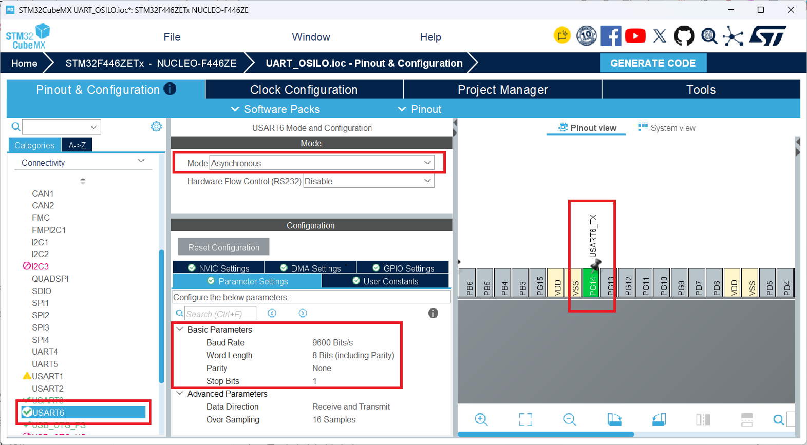
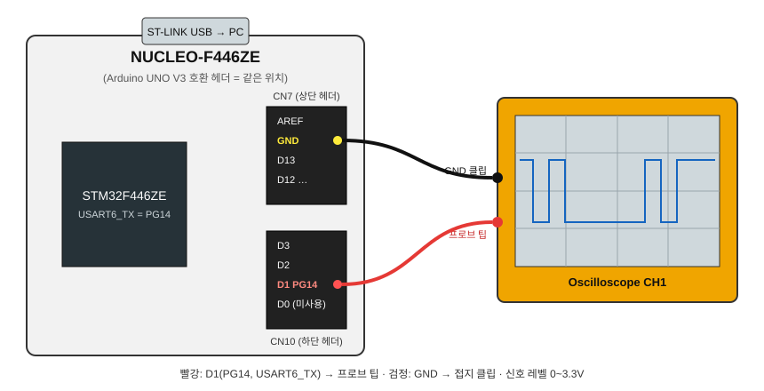
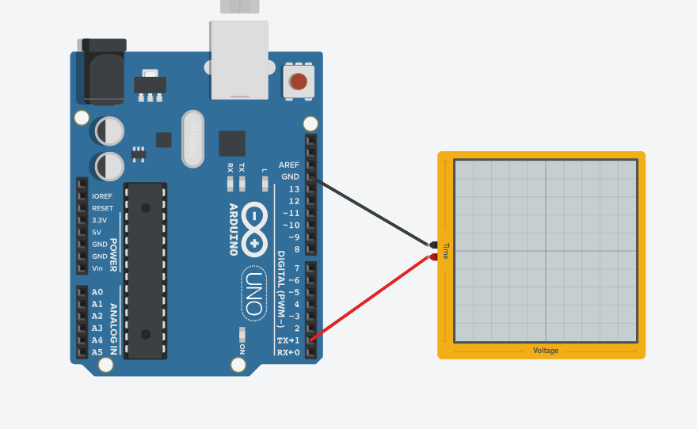

# UART · PG14로 'A' 송신 (HAL → 레지스터)

USART6으로 `'A'`(0x41)를 1초마다 보냅니다. 먼저 HAL로 동작을 확인하고, 그다음 **HAL이 실제로 어떤 레지스터를 쓰는지** 따라가서 레지스터로 직접 제어하는 것이 목표입니다.

- 보드: NUCLEO-F446ZE (STM32F446ZETx)
- USART6: **TX = PG14** (Arduino 헤더 D1), RX = PC7
- 설정: **9600bps, 8N1**
- 클럭: HSE 8MHz → PLL → SYSCLK 168MHz, APB2 = /2 → **PCLK2 84MHz** (USART6는 APB2 버스)
- 참고 문서: RM0390 (Reference Manual), DS10693 (Datasheet), UM1974 (NUCLEO-144)

> `main.c`에는 `huart3`(115200)도 있습니다. 이건 ST-LINK 가상 COM 포트용 **USART3**(PD8/PD9)입니다. PG14로 나가는 건 `huart6`(9600)입니다.

## 1. CubeMX 설정



| 항목 | 값 |
|---|---|
| Mode / Flow Control | Asynchronous / Disable |
| Baud Rate | 9600 Bits/s |
| Word Length / Parity / Stop | 8 Bits / None / 1 |
| USART6_TX 핀 | **PG14** (기본값 PC6에서 변경) |

## 2. HAL 코드

```c
/* main.c, while(1) 안 */
uint8_t ch = 'A';
HAL_UART_Transmit(&huart6, &ch, 1, HAL_MAX_DELAY);
HAL_Delay(1000);
```

## 3. HAL → 레지스터 따라가기

VSCode에서 함수/매크로 위에 커서를 두고 **F12**(또는 Ctrl+클릭)를 누르면 정의로 이동합니다. 돌아올 때는 **Alt+←**를 누릅니다.

| 단계 | HAL 코드 | 정의 위치 | 실제로 쓰는 레지스터 |
|---|---|---|---|
| ① 클럭 | `__HAL_RCC_GPIOG_CLK_ENABLE()`<br>`__HAL_RCC_USART6_CLK_ENABLE()` | `stm32f4xx_hal_rcc_ex.h` / `stm32f4xx_hal_rcc.h` | `RCC->AHB1ENR`, `RCC->APB2ENR` |
| ② 핀 | `HAL_GPIO_Init(GPIOG, ...)` | [stm32f4xx_hal_gpio.c:164](Drivers/STM32F4xx_HAL_Driver/Src/stm32f4xx_hal_gpio.c#L164) | `OSPEEDR`, `OTYPER`, `PUPDR`, `AFR[1]`, `MODER` |
| ③ USART 설정 | `HAL_UART_Init()` → `UART_SetConfig()` | [stm32f4xx_hal_uart.c](Drivers/STM32F4xx_HAL_Driver/Src/stm32f4xx_hal_uart.c) | `CR1`, `CR2`, `CR3`, `BRR` |
| ④ 송신 | `HAL_UART_Transmit()` | [stm32f4xx_hal_uart.c:1135](Drivers/STM32F4xx_HAL_Driver/Src/stm32f4xx_hal_uart.c#L1135) | `SR`(TXE 대기) → `DR`(쓰기) |

`GPIOG`, `USART6`이 무엇인지도 따라가 보면 결국 **주소에 구조체를 씌운 포인터**라는 걸 알 수 있습니다.

```c
// stm32f446xx.h
#define GPIOG_BASE   (AHB1PERIPH_BASE + 0x1800UL)    // 0x4002 1800
#define USART6_BASE  (APB2PERIPH_BASE + 0x1400UL)    // 0x4001 1400
#define GPIOG        ((GPIO_TypeDef *)  GPIOG_BASE)
#define USART6       ((USART_TypeDef *) USART6_BASE)
```

`GPIO_TypeDef`, `USART_TypeDef`의 멤버 순서는 RM0390 레지스터 맵의 오프셋 순서와 같습니다.

## 4. 레지스터 정리

### 4-1. 주소

| 주변장치 | 버스 | Base |
|---|---|---|
| RCC | AHB1 | `0x4002 3800` |
| GPIOG | AHB1 | `0x4002 1800` |
| USART6 | APB2 | `0x4001 1400` |

### 4-2. RCC: 클럭 켜기

| 레지스터 | 주소 | 비트 | 값 |
|---|---|---|---|
| RCC_AHB1ENR | `0x4002 3830` | bit 6 `GPIOGEN` | 1 |
| RCC_APB2ENR | `0x4002 3844` | bit 5 `USART6EN` | 1 |

클럭이 꺼져 있으면 그 주변장치 레지스터에 써도 반영되지 않습니다(읽으면 0).

### 4-3. GPIOG: PG14 = AF8 (USART6_TX)

핀 n은 2비트 필드에서 `[2n+1:2n]` 위치를 씁니다. PG14는 **[29:28]**입니다. AF 번호는 4비트 필드이고, 핀 8~15는 `AFR[1]`(AFRH)에 들어갑니다. PG14는 `AFR[1]`의 **[27:24]**입니다.

| 레지스터 | 오프셋 | PG14 비트 | 값 | 의미 |
|---|---|---|---|---|
| MODER | `0x00` | [29:28] | `10` | Alternate function |
| OTYPER | `0x04` | 14 | `0` | Push-pull |
| OSPEEDR | `0x08` | [29:28] | `11` | Very high speed |
| PUPDR | `0x0C` | [29:28] | `00` | No pull |
| AFR[1] (AFRH) | `0x24` | [27:24] | `1000` | **AF8 = USART6** |

AF8 = USART6_TX라는 정보는 데이터시트(DS10693)의 Alternate function 표에 있습니다.

### 4-4. USART6

| 레지스터 | 오프셋 | 역할 |
|---|---|---|
| SR | `0x00` | 상태 (TXE, TC, RXNE …) |
| DR | `0x04` | 송수신 데이터 |
| BRR | `0x08` | 보드레이트 |
| CR1 | `0x0C` | enable, 데이터 길이, 패리티, TX/RX |
| CR2 | `0x10` | Stop 비트 |
| CR3 | `0x14` | 흐름제어, DMA |

**BRR 계산** (OVER8 = 0, 16배 오버샘플링)
```
USARTDIV = f_PCLK2 / (16 × Baud) = 84,000,000 / (16 × 9600) = 546.875
Mantissa = 546           = 0x222
Fraction = 0.875 × 16    = 14 = 0xE
BRR      = (0x222 << 4) | 0xE = 0x222E
```

**CR1**

| 비트 | 이름 | 값 | 의미 |
|---|---|---|---|
| 13 | UE | 1 | USART enable |
| 12 | M | 0 | 8비트 데이터 |
| 10 | PCE | 0 | 패리티 없음 |
| 3 | TE | 1 | 송신 enable |
| 2 | RE | 1 | 수신 enable |

→ CR1 = `0x200C` (송신만 쓸 거면 `0x2008`), CR2 = `0` (Stop 1비트), CR3 = `0`

**SR**

| 비트 | 이름 | 의미 |
|---|---|---|
| 7 | TXE | DR이 비었음 → 다음 바이트를 써도 됨 |
| 6 | TC | 마지막 비트까지 송신 완료 |
| 5 | RXNE | 수신 데이터 있음 |

### 4-5. 레지스터로 직접 'A' 보내기

HAL 대신 아래 코드로 같은 동작을 할 수 있습니다. `HAL_Init()`과 `SystemClock_Config()`는 그대로 두고(PCLK2 = 84MHz 전제), `MX_USART6_UART_Init()` 대신 호출합니다.

```c
static void usart6_init_reg(void)
{
    /* ① 클럭 */
    RCC->AHB1ENR |= RCC_AHB1ENR_GPIOGEN;
    RCC->APB2ENR |= RCC_APB2ENR_USART6EN;

    /* ② PG14 = AF8 */
    GPIOG->MODER   = (GPIOG->MODER   & ~(3U << 28))   | (2U << 28);   // AF
    GPIOG->OSPEEDR |=  (3U << 28);                                    // very high
    GPIOG->PUPDR   &= ~(3U << 28);                                    // no pull
    GPIOG->AFR[1]  = (GPIOG->AFR[1]  & ~(0xFU << 24)) | (8U << 24);   // AF8

    /* ③ USART6: 9600 8N1 */
    USART6->CR1 = 0;                       // 설정 중에는 끄기
    USART6->BRR = 0x222E;                  // 84MHz / 9600
    USART6->CR2 = 0;                       // stop 1
    USART6->CR3 = 0;                       // flow control 없음
    USART6->CR1 = USART_CR1_TE | USART_CR1_UE;
}

static void usart6_putc(uint8_t c)
{
    while (!(USART6->SR & USART_SR_TXE));  // ④ DR 빌 때까지 대기
    USART6->DR = c;
}

/* while(1) 안 */
usart6_putc('A');
HAL_Delay(1000);
```

## 5. 레지스터 값 확인 (디버거)

`while (1)`에 브레이크포인트를 걸고 Debug Console에서 확인합니다.

```
x/6wx 0x40011400    # USART6: SR, DR, BRR, CR1, CR2, CR3
x/1wx 0x40021800    # GPIOG_MODER
x/1wx 0x40021824    # GPIOG_AFRH
```

| 레지스터 | 기대값 |
|---|---|
| USART6_BRR | `0x0000 222E` |
| USART6_CR1 | `0x0000 200C` (HAL) / `0x0000 2008` (위 레지스터 코드) |
| USART6_SR (대기 중) | `0x0000 00C0` 근처 (TXE, TC = 1) |
| GPIOG_MODER | `0x2000 1000` (PG14 = AF, PG6 = Output) |
| GPIOG_AFRH | `0x0800 0000` |

Watch 창에 `USART6->BRR`, `GPIOG->MODER`처럼 입력해도 됩니다. STM32Cube Registers 확장을 쓰면 비트 단위로 볼 수 있습니다.

## 6. 연결 / 파형 확인

| NUCLEO 헤더 | STM32 핀 | 연결 |
|---|---|---|
| D1 (CN10) | **PG14** (USART6_TX) | 오실로스코프 프로브 / USB-TTL RX |
| GND (CN7) | GND | 접지 |





9600bps에서 1비트는 약 **104µs**입니다. `'A'` = `0x41` = `0100 0001`은 LSB부터 나갑니다.
```
Start  b0 b1 b2 b3 b4 b5 b6 b7  Stop
  0     1  0  0  0  0  0  1  0    1
```
오실로스코프 설정: DC, 1V/div, 100µs/div, Falling edge 트리거 ≈1.5V
