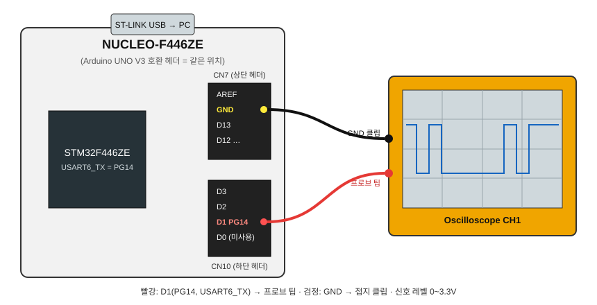
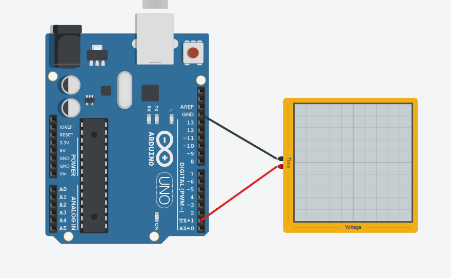
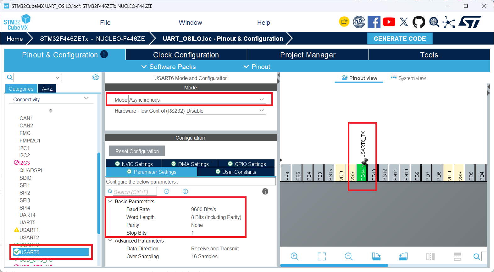

# UART_OSILO

USART6으로 `'A'`(0x41)를 반복 전송하고 **오실로스코프로 UART 파형**을 관찰하는 실습입니다.
같은 데이터를 비트 단위 문자열로 USART3(ST-LINK 가상 COM 포트)에 출력해서 **PC 시리얼 모니터**로도 비교할 수 있습니다.

- 보드: NUCLEO-F446ZE (STM32F446ZETx)
- 시스템 클럭: 168MHz (HSE 8MHz bypass → PLL)

## 동작

| UART | 핀 | 속도 | 보내는 데이터 | 확인 방법 |
|---|---|---|---|---|
| **USART6** | **PG14 (TX)** · Arduino 헤더 D1 | 9600bps, 8N1 | `'A'` 1바이트 | 오실로스코프 |
| **USART3** | PD8 (TX) / PD9 (RX) · ST-LINK VCP | 115200bps, 8N1 | `A 0x41 bin:01000001 wire:0 10000010 1` | PC 시리얼 모니터 |

전송 주기: 약 14.5ms (USART6 1.04ms + USART3 약 3.4ms + `HAL_Delay(10)`)

## 회로 연결

NUCLEO-F446ZE에는 **Arduino UNO V3와 같은 위치의 헤더**가 있어서, Arduino 기준 회로도의 핀 위치를 그대로 쓸 수 있습니다.

**실제 연결 (NUCLEO-F446ZE)**



**참고: Arduino UNO 기준 회로도 (Tinkercad)**



| Arduino UNO 핀 (회로도) | NUCLEO-F446ZE 헤더 | STM32 실제 핀 | 기능 | 오실로스코프 |
|---|---|---|---|---|
| **TX→1** | **D1** (CN10) | **PG14** | USART6_TX | **프로브 팁 (빨강)** |
| RX←0 | D0 (CN10) | PG9 | (이 프로젝트에서는 미사용 · USART6_RX는 PC7에 설정됨) | 연결 안 함 |
| **GND** (AREF 옆) | **GND** (CN7) | GND | 기준 전위 | **접지 클립 (검정)** |

> ⚠️ 전압 차이: Arduino UNO는 **5V** 로직, NUCLEO(STM32)는 **3.3V** 로직입니다. 오실로스코프에서 HIGH가 약 3.3V로 보이는 게 정상입니다.

## CubeMX 설정 (USART6)



`Pinout & Configuration → Connectivity → USART6`

| 항목 | 값 |
|---|---|
| Mode | **Asynchronous** |
| Hardware Flow Control (RS232) | Disable |
| Baud Rate | **9600 Bits/s** |
| Word Length | 8 Bits (including Parity) |
| Parity | None |
| Stop Bits | 1 |
| Data Direction | Receive and Transmit |
| Over Sampling | 16 Samples |
| **USART6_TX 핀** | **PG14** (= Arduino D1. 기본값 PC6에서 변경: 핀 뷰에서 PG14 클릭 → `USART6_TX` 선택) |
| USART6_RX 핀 | PC7 (기본값 유지, 이 실습에서는 송신만 사용) |

USART3는 NUCLEO 보드 기본값(PD8/PD9, 115200bps, ST-LINK VCP 연결)을 그대로 사용합니다.

> 설정을 바꾼 뒤 **GENERATE CODE**를 누르세요. `USER CODE BEGIN/END` 사이에 작성한 코드는 재생성해도 유지됩니다.

## 코드 핵심 ([Core/Src/main.c](Core/Src/main.c))

```c
uint8_t ch = 'A';                          // 오실로스코프용 1바이트
char msg[64];
uint16_t len = make_bit_string(ch, msg);   // "A 0x41 bin:01000001 wire:0 10000010 1\r\n"

while (1)
{
  HAL_UART_Transmit(&huart6, &ch, 1, 100);              // USART6 → 오실로스코프
  HAL_UART_Transmit(&huart3, (uint8_t *)msg, len, 100); // USART3 → 시리얼 모니터
  HAL_Delay(10);
}
```

- `bin:` 사람이 읽는 순서 (MSB → LSB)
- `wire:` 실제로 선에 나가는 순서 = **Start(0) + LSB부터 8비트 + Stop(1)**, 즉 오실로스코프 화면 왼쪽부터 보이는 순서

## 빌드 & 업로드

```bash
cmake --preset Debug
cmake --build --preset Debug
# 결과: build/Debug/UART_OSILO.elf
```

VS Code에서 F5로 올리거나, STM32CubeProgrammer로 `.elf`를 다운로드합니다.

## 시리얼 모니터

| 항목 | 값 |
|---|---|
| Port | STMicroelectronics STLink Virtual COM Port (장치 관리자에서 COM 번호 확인) |
| Baud rate | **115200** |
| Data / Parity / Stop | 8 / None / 1 |

출력 예:
```
A 0x41 bin:01000001 wire:0 10000010 1
A 0x41 bin:01000001 wire:0 10000010 1
```

## 오실로스코프 설정 (PG14, 9600bps, 3.3V)

| 항목 | 값 |
|---|---|
| 프로브 | **PG14 (D1)** / **GND**, ×10 (채널 Probe 설정도 10X) |
| Coupling | DC |
| V/div | 1V |
| Time/div | 100µs (한 글자 ≈ 1.04ms가 화면 가득) · 간격을 보려면 5ms |
| Trigger | Edge, **Falling**, Level ≈ 1.5V, Mode Normal |
| UART 디코드 (있으면) | 9600, 8N1, Idle High, LSB first, Threshold 1.5V |

기대 파형 (1비트 ≈ 104µs):
```
3.3V ‾‾‾‾|  |‾‾|              |‾‾|  |‾‾‾‾‾‾
  0V     |__|  |______________|  |__|
       Start 1  0  0  0  0  0  1  0  Stop
```

체크 포인트
- HIGH ≈ 3.3V, LOW ≈ 0V
- 가장 좁은 펄스 ≈ 104µs
- 파형이 흐르면 트리거 Level 확인, 전압이 10배 틀리면 프로브 배율(×1/×10) 확인
